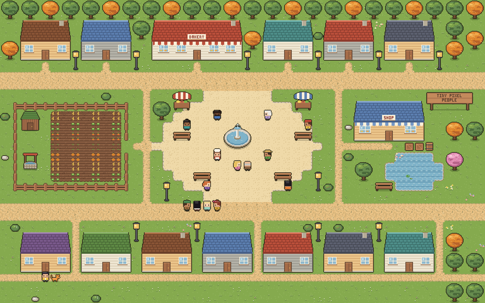

# Tiny Pixel People

A tiny top-down pixel village whose 10–20 villagers are driven by LLMs, in the spirit of
[Generative Agents](https://arxiv.org/abs/2304.03442) (Smallville). Each villager has a memory
stream, reflects on what happened, plans its day, chats and gossips with its neighbours, organises
small events, and answers the notes you pin to its door. You walk around the village as yourself,
with your cat Pip, earn gold, collect things in your backpack and decorate your cottage.

It runs fully offline with a local [Ollama](https://ollama.com), or against any OpenAI-compatible
server (LM Studio, vLLM, llama.cpp, OpenRouter, …), Anthropic or Gemini. The provider and model are
chosen in a config file; no code changes needed.



## Quick start

You need [Node.js](https://nodejs.org) 22.12 or newer and, for local models,
[Ollama](https://ollama.com) with a chat model and an embedding model:

```sh
ollama pull qwen2.5:7b
ollama pull nomic-embed-text
```

Then, in the repository folder:

```sh
npm install && npm start
```

Open <http://127.0.0.1:3000>. That's it: the defaults use Ollama on `127.0.0.1:11434` with
`qwen2.5:7b`. After `npm install` no internet connection is needed.

To use another provider or model, copy `config.example.json` to `config.json` and edit the `llm`
section, or set environment variables. See [Providers](docs/setup/providers.md).

## What you can do

- Watch villagers wake up, plan their day, walk to work, eat, chat and go to bed. Click a villager
  to see its current thought, needs, today's plan, friends and recent memories.
- Pin a note to a villager's door. The owner reads it the next time they come home and writes a
  reply.
- Tell a villager a rumor and follow it from villager to villager in the rumor tracker.
- Trigger world events from the toolbar: rain, a party, a stranger, a birthday or a town event.
- Run the clock at pause, 1×, 2×, 4× or 8×.
- Walk around, pick up flowers and apples, give gifts, earn gold, decorate your cottage, and take
  Pip for a walk.

The [user guide](docs/user-guide.md) explains everything in detail.

## Documentation

| Document                                               | What's in it                                                       |
| ------------------------------------------------------ | ------------------------------------------------------------------ |
| [User guide](docs/user-guide.md)                       | How to play: controls, inspector, notes, rumors, events, gold, pet |
| [Installation](docs/setup/installation.md)             | Requirements, install, start, update, run on another port          |
| [Ollama setup](docs/setup/ollama.md)                   | Local models and which one to pick for your RAM / GPU              |
| [Providers](docs/setup/providers.md)                   | OpenAI-compatible, LM Studio, vLLM, OpenRouter, Anthropic, Gemini  |
| [Configuration reference](docs/setup/configuration.md) | Every config key, its default, and the environment variables       |
| [Troubleshooting](docs/troubleshooting.md)             | Common problems and fixes                                          |
| [Architecture](docs/architecture.md)                   | How the server, cognition, LLM queue and client fit together       |
| [Acceptance tests](docs/acceptance.md)                 | Running the test suite and the live check against a real model     |
| [Specs](docs/spec/)                                    | The original spec, the technical spec and the visual style guide   |

## Development

```sh
npm run dev        # server (tsx watch) + Vite dev server with /ws proxy
npm run lint
npm run typecheck
npm test           # unit + acceptance tests with the mock provider, no network
npm run check      # lint, typecheck, tests and build (what CI runs, plus format:check)
npm run format
```

Layout: `src/shared` (types and the WebSocket protocol), `src/server` (config, llm, sim, cognition,
player, persistence, net), `src/client` (canvas renderer and UI), `data` (villagers, items,
decorations, strangers), `assets` (art, see `assets/CREDITS.md`), `docs`, `test`, `scripts`.
Contributors: read [AGENTS.md](AGENTS.md) and the [architecture](docs/architecture.md) first.

## License

MIT, see [LICENSE](LICENSE). The pixel art is original and generated by code in `scripts/art/`.
Fonts and any third-party assets keep their own licenses, listed in
[`assets/CREDITS.md`](assets/CREDITS.md).
