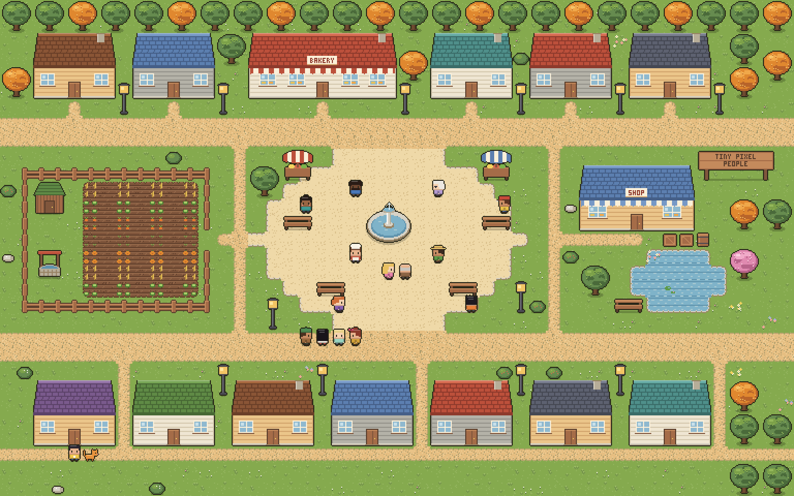

# Art assets

All game art is original pixel art drawn by code in `scripts/art/`. Regenerate it with:

```sh
npm run art
```

The output is deterministic. `test/unit/art-assets.test.ts` fails if the committed JSON is out of
date or if the map has unreachable doors, entries or spots. Previews of everything live in this
folder: `map-day.png`, `map-night.png`, `scene-home-x4.png`, `characters-x3.png`, `icons-x4.png`,
`tileset-x2.png` and `decorations-x4.png`.

The look follows the user's reference video (`docs/reference/`). In short: top-down, chunky
16-px pixel art, warm spring greens with sandy paths, and a 1-px dark olive outline (`#272618`,
never pure black). The UI is a flat, dark, translucent overlay with a yellow accent.



## Rendering rules

- Use integer scale only (2× for the whole town, 4× for zoomed scenes), set
  `imageSmoothingEnabled = false` and `image-rendering: pixelated`, and snap the camera to whole
  art pixels.
- Draw order: `ground` → `decor` → villagers, pet and props sorted by y → `overhead` (roofs, tree
  tops, lamp heads) → bubbles and name tags → UI.
- At night, multiply the world by about `rgb(0.42, 0.5, 0.58)`, swap lit tiles (see `lit` below) so
  windows glow, then draw `ui/glow.png` additively at each light from `maps/village.meta.json`.
  Fade the tint over dusk (18:00–20:00) and dawn (05:00–07:00). See `map-night.png`.

## Files

### `assets/tiles/village.png` + `village.json`

The tileset uses 16×16 tiles, 16 columns, and row-major indices. `village.json` contains:

- `tiles`: maps each tile name to its index. Naming:
  - `grass_0..5` are grass variants.
  - `path_<mask>`, `sand_<mask>`, `water_<mask>`, `soil_<mask>` and `fence_<mask>` are autotiles.
    The mask is a 4-bit number: `N=1 E=2 S=4 W=8`, and a bit is set when the neighbour on that
    side is the same terrain. Path and sand count as the same terrain for this purpose.
  - Objects are sliced into `<object>_<x>_<y>`.
- `objects`: each multi-tile object (`tree_green`, `lamp`, `bench`, `fountain`, `house_<colour>`,
  `bakery`, `shop`, `stall_red`, `sign_town`, `deco_*`, and so on). Each entry has its size, the
  tile names per layer, a collision mask, and anchors such as `door`.
- `lit`: maps a day tile index to its night variant (lit windows and lanterns).

Houses come in `brown`, `blue`, `teal`, `purple` (the player cottage), `red`, `green` and `slate`.

### `assets/characters/*.png` + `index.json`

- Each sheet is 64×96: 4 columns (walk frames 0–3) by 4 rows (`down`, `left`, `right`, `up`).
  Frames are **16×24**, so hats fit. The feet anchor is at (8, 22), so a villager on tile (tx, ty)
  is drawn at `(tx*16, ty*16 - 8)`.
- Walk at about 8 fps. Idle uses frame 0, with an optional 1-px bob every 0.5 s.
- `villager-01` to `villager-20` are 20 distinct villagers. Each `index.json` entry has a
  `description` and a `suggestedRole` (for example `villager-01` is the baker), so
  `data/villagers.json` can pick a `sprite` that fits.
- `player.png` is the player avatar (yellow shirt). Draw its name tag with a `★` prefix.
- `stranger.png` is the cloaked traveller for the Stranger event.
- `pet-pip.png` is Pip, the player's orange cat, with the same sheet layout.

### `assets/ui/icons.png` + `icons.json`

The sheet holds 16×16 icons in 8 columns; `icons.json` maps names to indices. Draw them at 1× or
2× in the UI, and use them for world markers (`note` and `reply` on doors, `zzz`, `thinking`,
`chat`, `heart`). The groups are:

| Group           | Icons                                                                                      |
| --------------- | ------------------------------------------------------------------------------------------ |
| Controls        | `pause`, `play`, `fast`, `zoom_in`, `zoom_out`, `fit`, `close`, `save`, `clock`            |
| Events          | `rain`, `party`, `stranger`, `birthday`, `town_event`, `cake`, `music`, `picnic`           |
| Dock / scenes   | `map`, `home`, `backpack`, `paw` (pet), `decorate`, `coin` (gold)                          |
| Social          | `rumor`, `note`, `reply`, `pin`, `heart`, `heart_empty`, `chat`, `thinking`, `zzz`, `star` |
| Needs bars      | `hunger`, `energy`, `social`, `fun`                                                        |
| Inventory items | `coin`, `silver`, `seed`, `bread`, `honey`, `flower`, `gem`, `apple`                       |
| Status          | `offline`, `model`, `agents`, `moon`, `sun`                                                |

`ui/glow.png` is a 64×64 warm radial light for lamps and windows at night.

### Decorations (home decorating)

The `deco_*` objects in `village.json` cover every decoration item: `deco_rug` (welcome rug),
`deco_cushion` (porch cushion), `deco_vase` (flower vase), `deco_lantern` (lit at night),
`deco_flowerpots`, `deco_bench` (garden bench), `deco_string_lights` (5 tiles, overhead),
`deco_mailbox`, `deco_flag` and `deco_birdbath`. The decorating UI can use the object's first tile
as its card icon. `door_note` is the paper pinned to a door when a note is waiting.

### `assets/maps/village.json` + `village.meta.json` (the map)

- `village.json` is a `WorldMap` (`src/shared/types.ts`), 128×60 tiles (spec v2 §2). The v1 town
  keeps its place at x 0–47, y 0–29 with the same location ids, rects, entries, doors and building
  tiles. New districts: `post_row`, `zoo` (12 enclosures, rides), `forest` (lake, grove),
  `farmstead` (pastures, coop, barn, farmhouse, butcher), `market` and `station` (with the hotel).
- It also holds `districts`, `railway` (`rows: [56, 58]`, `platform`; the bed is blocked except at
  the level crossings at x 44–45 and 110–111) and `interiors`.
- `interiors` are small separate maps that use the same tileset: `cottage_a`, `cottage_b` and
  `cottage_c` (12×8, for houses), `hotel_lobby` and `post_office` (14×8). The post office template
  lists the clickable `keep_cupboard` in `objects`. Rows 0–1 are the back wall and the bottom row
  holds the door (`exit`). Preview: `docs/art/interiors-x3.png`.
- `npm run art` writes the same map to `data/map/village.json` and keeps the sim's location
  fields (names, `ownerIds`) for ids that already exist there, so the two files differ only in
  `locations`.
- `village.meta.json` holds:
  - `lights`: lamp and window positions for the night glow.
  - suggested decoration and item catalogues.
- Previews: `docs/art/map-v2-day.png` and `map-v2-night.png`. `map-day.png` and `map-night.png`
  still show the v1 town on its own.

## UI styling (screen overlay, not pixel art)

See `docs/reference/` for frames and the full style guide.

| Element       | Style                                                                                                  |
| ------------- | ------------------------------------------------------------------------------------------------------ |
| Panel         | `#182017` at about 90% opacity, 1-px `#ffffff1a` border, 8–10 px radius                                |
| Text          | primary `#fef7e5`, labels `#b9bdb6` in small caps with 0.15em letter spacing                           |
| Accent        | `#f2c94c` (LIVE badge, active speed, titles)                                                           |
| Speech bubble | `#fffaea` fill, 1 art-px `#272618` border, tail toward the speaker, max about 160 art px wide, 2 lines |
| Name tag      | `#3c2b17` pill with `#fbf0d9` text, under the feet                                                     |
| Needs bars    | hunger `#f08a4b`, energy `#7cc6f2`, social `#e872b8`, fun `#8fd16a`                                    |
| Fonts         | Departure Mono (body, bubbles), Silkscreen (labels), both SIL OFL; bundle them locally                 |
