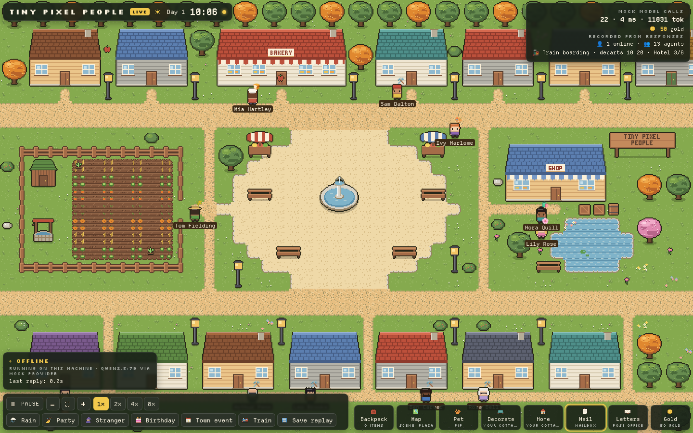

# User guide

Tiny Pixel People is a small village that lives on its own. Twelve villagers (up to eighteen with
the bundled profiles) wake up, plan their day with a language model, go to work, eat, chat, gossip,
fall in love, throw parties and go to bed. Around the old town there is a zoo with rides, a farm
whose animals are born and grow old, a forest, a post office, and a station where visitors arrive
by train and stay at the hotel. You live there too: you have a cottage, a cat called Pip, a
backpack and some gold. You can talk to villagers, leave notes on their doors, write letters, walk
into their houses, start rumors, and stir things up with rain or a party.

This guide assumes the game is running. If it isn't, see the [README](../README.md) quick start or
[Installation](setup/installation.md).



- [The screen](#the-screen)
- [Time and speed](#time-and-speed)
- [Moving around and the camera](#moving-around-and-the-camera)
- [Keyboard shortcuts](#keyboard-shortcuts)
- [Villagers and the inspector](#villagers-and-the-inspector)
- [Talking to villagers](#talking-to-villagers)
- [Door notes](#door-notes)
- [Rumors and the rumor tracker](#rumors-and-the-rumor-tracker)
- [Village events](#village-events)
- [World events (toolbar)](#world-events-toolbar)
- [Gold](#gold)
- [Backpack and gifts](#backpack-and-gifts)
- [Pip, your pet](#pip-your-pet)
- [Decorating your cottage](#decorating-your-cottage)
- [The bigger village](#the-bigger-village)
- [The zoo](#the-zoo)
- [The farm](#the-farm)
- [The train, visitors and the hotel](#the-train-visitors-and-the-hotel)
- [Going inside houses](#going-inside-houses)
- [The post office](#the-post-office)
- [Laude and Franzi](#laude-and-franzi)
- [Romance and dates](#romance-and-dates)
- [The forest](#the-forest)
- [Saving and loading](#saving-and-loading)
- [When the model is slow](#when-the-model-is-slow)
- [Watching from another program](#watching-from-another-program-observer-api)
- [Tips](#tips)

## The screen

The village fills the window. A dark, see-through interface floats on top of it:

| Where         | What                                                                                                                                                                                                                                                                                                                                                      |
| ------------- | --------------------------------------------------------------------------------------------------------------------------------------------------------------------------------------------------------------------------------------------------------------------------------------------------------------------------------------------------------- |
| Top left      | The HUD: `TINY PIXEL PEOPLE`, a status badge (`LIVE`, `PAUSED`, or `CONNECTING` / `OFFLINE` when the browser lost the server), the weather, the day and the clock. The rumor tracker opens below it.                                                                                                                                                      |
| Top right     | The stats card: `REAL MODEL CALLS` (calls · total time · tokens), your gold and up to three item counts, how many players are online and villagers live here, the next train and the hotel (`🚂 Next train 16:00 · Hotel 3/6`), and, while calls are waiting, `N in queue · F failed`. See [Performance](setup/performance.md) for what the numbers mean. |
| Bottom left   | The LLM card: where the villagers think. `✈ OFFLINE` with `RUNNING ON THIS MACHINE · QWEN2.5:7B VIA OLLAMA` means a local model, no internet needed; `☁ ONLINE` means a hosted API. `⚠ MODEL UNREACHABLE` means the model doesn't answer. The last line shows how long the last reply took.                                                               |
| Bottom        | The toolbar: `PAUSE`, zoom (`−`, fit, `+`), the speed buttons `1× 2× 4× 8×`, and the world event buttons, including 🚂 Train. On narrower windows the event buttons show only their icons; hover for the name.                                                                                                                                            |
| Bottom centre | The place bar, when there is something to do where you stand: buy food, ride a ride, write a letter or read the notice board, and `🏠 Inside …` with `🚪 Exit` while you are inside a house.                                                                                                                                                              |
| Bottom right  | The dock: `Backpack`, `Map`, `Pet`, `Decorate`, `Home`, `Mail` (your mailbox), `Letters` and `Gold`. `Mail` and `Letters` show how many new ones are waiting.                                                                                                                                                                                             |
| Right         | The inspector, when you click a villager. Clicking an animal opens a small animal card: its name and species, and for farm and zoo animals also the stage (baby, adult, elder), male or female, its age in days and what it is doing. Forest animals and the crow show only their name and species.                                                       |

Short messages ("toasts") pop up at the bottom centre, for example `📮 Mailbox placed at your
cottage ✓`. Your conversations with villagers appear in a small dialog there too.

## Time and speed

- One game day takes 15 real minutes at 1× by default (`sim.dayLengthMinutes`). A new village starts
  at 06:00 on day 1.
- The speed buttons run the clock at 1×, 2×, 4× or 8×. `PAUSE` stops the clock and all movement (the
  button then shows `PLAY`). Language model replies already on their way still arrive while paused.
- Villagers sleep at night. Each one has its own hours: early birds get up at 05:00, late risers at
  08:00, and bedtimes are between 21:00 and 23:30. While everybody sleeps, the clock runs 6× faster on
  top of the chosen speed (`sim.nightSpeedMultiplier`), so nights pass quickly.
- **Waking up.** At 06:00 each day the clock waits until every villager's plan for the day is ready,
  so the day starts with real plans. A small banner at the top centre shows
  `🌅 Villagers are waking up… (n/m plans ready)` with a progress bar. The banner doesn't block
  the screen: you can still open the inspector and send messages, but nobody moves until the clock
  runs again. The clock goes on once every villager's plan request has finished (with a
  plan from the model, or a default plan if the model's answer couldn't be used), when the model is
  unreachable, or after 5 real minutes at most (`sim.wakeUpTimeoutSec`; `0` turns the wait off).
  Villagers still without a plan then start the day on a default plan.
- The town darkens in the evening, lamps and windows glow at night, and it gets light again in the
  morning.

At higher speeds the language model has less real time per game hour, so villagers "think slower" in
game time: a conversation takes longer, or a villager follows a simple default plan until its real
plan arrives (it keeps asking until noon). That's expected; apart from the short wait at 06:00, the town never waits for the
model.

## Moving around and the camera

- **Click empty ground** to walk there. Your avatar has a `★` in front of its name tag. Pip follows
  you.
- **Drag** to pan the camera; **scroll** to zoom. The toolbar `−` and `+` zoom too, and the fit button
  shows the whole map (the overview) again.
- **Map** (dock) opens the scene switcher: Plaza (the whole old town), Farm, Shop street, Park, Town
  square and Your home, plus Overview (the whole map) and one scene per new district (see
  [The bigger village](#the-bigger-village)). The camera moves to the scene you pick and follows it until you pan. The Map tile
  shows the current scene, or `free` after you pan.
- **Home** (dock) jumps the camera to your cottage, the purple-roofed house at the bottom left of the old town.

## Keyboard shortcuts

| Key              | Does                                                            |
| ---------------- | --------------------------------------------------------------- |
| `Space`          | Pause / resume (when you aren't typing)                         |
| `+` / `-`        | Zoom in / out                                                   |
| `0`              | Fit the whole map                                               |
| `h`              | Show your home                                                  |
| `Escape`         | Close the open window, then the chat dialog, then the inspector |
| `Enter`          | In the inspector's text field: Say                              |
| `Ctrl/⌘ + Enter` | In the door note window: pin the note                           |

## Villagers and the inspector

Every villager shows a name tag and, when busy, a small emoji for what it is doing. Speech bubbles
appear over villagers who are talking; the full text is in the inspector. Sleeping villagers are
indoors, with a `z` over their door.

Click a villager to open the **inspector** on the right. Click `×` (or press `Escape`) to close it.
From top to bottom it shows:

- **Name**, **occupation and age**, and the villager's **traits and bio**.
- **Current thought**: what it last said, or what it is doing now.
- **Needs**: hunger, energy, social and fun, each 0–100 %. Needs drop over the day and refill with
  the right activity: eating at the café or at home, sleeping, chatting, parties, the park and
  hobbies. When a need drops very low, the villager squeezes in a short break to fix it, for example
  "grab a bite at the café".
- **Today's plan**: the day's blocks as a checklist (`☐ 07:00 🍞 bake bread at Bakery & Café`),
  always with at least two different places (a
  villager whose plan would keep it in one place gets a lunch break or a walk somewhere else). Done
  blocks are ticked and the current one is highlighted. `· fallback` next to the title means the
  model hasn't delivered a usable plan (yet) and the villager follows a simple default. Blocks you asked for
  carry a `your request` tag.
- **Friends ❤ n**: n is the number of close friends; below are the five villagers (or you) it likes
  most, with their affinity from −10 to +10.
- A **text field** with a `Say` button, and the actions described in the next section.
- **🏠 Lives in** and **📍 Now** (what it is doing and where).
- **Recent memories · knows about you: n**: its last 10 memories, newest first. Memories that
  mention you are highlighted.

The inspector updates live while it is open.

## Talking to villagers

Open the inspector, type into the text field (up to 300 characters) and pick an action. Your avatar
first walks up to the villager if it is far away. Sleeping villagers can't be spoken to.

| Action                  | What happens                                                                                                                                                                                                      |
| ----------------------- | ----------------------------------------------------------------------------------------------------------------------------------------------------------------------------------------------------------------- |
| **Say** (or `Enter`)    | The chat dialog shows "… is thinking…", then the villager's answer. It remembers the chat.                                                                                                                        |
| **Ask to do it**        | A request, for example "Could you water the flowers in the park this afternoon?". The villager decides. If it agrees, the request appears in its plan with a `your request` tag, and you get gold when it's done. |
| **Tell as rumor**       | The villager hears your text as important news and may pass it on. A new rumor opens in the rumor tracker.                                                                                                        |
| **Have them talk**      | Pick a second villager in the dropdown first. The inspected villager walks over and they start a conversation right away.                                                                                         |
| **📍 Find them**        | Moves the camera to the villager and follows it.                                                                                                                                                                  |
| **🏠 Visit their home** | Walks your avatar to the villager's door and opens the door note window.                                                                                                                                          |

## Door notes

Every house has a door. Click a door (or use **Visit their home**) to open the note window, titled
`Note for <owner>'s door`. Type a note of up to 500 characters and press `📌 Leave a note`. The
same window has **🚪 Go inside** (see [Going inside houses](#going-inside-houses)) and lists the
notes, replies and letters at that door.

- A paper note appears on the door while it is unread.
- The owner reads it **the next time it is home and awake**. If the owner is already at home and
  awake, it reads it right away.
- Notes matter to villagers: the owner remembers it as an important memory, may change its plans
  because of it, may tell others about it, and writes a reply that refers to what you wrote.
- When the reply is ready, the door shows a reply marker. Click the door: the window lists your
  notes with their status (`pinned, not read yet`, `read`, `replied`) and the owner's reply.
- If the model takes more than about 3 game hours to write the reply, the owner posts a simple
  reply of its own that still mentions your note. A note that was read but not answered yet (for
  example because the server was restarted in between) gets its reply the next time the owner
  comes home.
- You can pin several notes on the same door. The owner reads them oldest first.

A note is also a rumor: the rumor tracker follows it once the owner has read it.

## Rumors and the rumor tracker

Villagers pass on news when they talk. Whatever you tell a villager with **Tell as rumor**, and every
door note once it is read, is tracked as a rumor. Villagers can start rumors too, when they hear
something they find very important.

Villagers don't just wait to bump into someone. A villager with fresh, important news (heard in
the last 12 game hours and told to fewer than two people so far) walks up to an awake villager who
hasn't heard it yet and starts a chat, at most every 30 game minutes. It doesn't do this during an
event, while doing something you asked for, or in the last hour before bed. If a chat ends right
after the news is told, the listener still reacts (`Really? …? I had no idea!`), so the news sticks.

The **rumor tracker** panel (top left, yellow border) opens with the first rumor and shows the newest
one:

```
🗣 RUMOR · 4 OF 10 VILLAGERS KNOW
You said: "The baker is secretly training for a marathon."
Mia Hartley → Tom Fielding  "Did you hear? The baker is training for a marathon!"
Tom Fielding → Ivy Marlowe  "Apparently Mia's been running every morning…"
```

Each line is one hop: who told whom, and how they put it (the last six hops are shown). Retellings
drift, just like real gossip. A rumor a villager started reads `<name> started: "…"`. With more than
one rumor, a dropdown in the panel picks older ones. `×` hides the panel until the rumor spreads
further or a new one starts.

## Village events

Villagers organise small events on their own: a bake-off, a picnic, a book club. The host picks a
place and a time and invites some neighbours. Each invitee decides whether to go, based on its plans
and how much it likes the host; others hear about it through gossip and may join. When the event
starts, the guests walk there and a banner floats over the place. If nobody has proposed an event by
07:00, the best-suited villager is asked to (`events.ensureDaily`), so there is time to invite
guests even on a slow model.

Go to an event yourself and stay for at least half of it to earn gold (see [Gold](#gold)).

## World events (toolbar)

The event buttons in the toolbar shake things up. Each one shows a toast, and villagers who notice
remember it.

| Button             | What happens                                                                                                                                                                                                                         |
| ------------------ | ------------------------------------------------------------------------------------------------------------------------------------------------------------------------------------------------------------------------------------ |
| 🌧 **Rain**         | It rains for 1–3 game hours. Villagers who planned to be outdoors (plaza, park, farm) go to the nearest shop or home instead, and go back to their plans when it stops. Not available while it is already raining.                   |
| 🎉 **Party**       | You throw a party at the plaza, starting in 30 game minutes and lasting 2 hours. Every villager who is awake is invited and decides whether to come. Only one party at a time.                                                       |
| 🕵 **Stranger**    | A traveller walks in from the edge of the map with a piece of news the villagers can gossip about. It leaves at 22:00 (the next evening if it arrived after 20:00). At most 20 villagers, strangers included.                        |
| 🎂 **Birthday**    | It's the birthday of the villager you are inspecting, or a random one. Everyone learns about it, and its friends are invited to a party at the Bakery & Café at 17:00 (or in 30 minutes if that's later). Once per villager per day. |
| 🗓 **Town event**   | The villager best suited to it proposes a new village event right now.                                                                                                                                                               |
| 💾 **Save replay** | Saves the game and, a second later, downloads `replay.jsonl`: a log of every conversation, event, rumor, note and world event so far.                                                                                                |

## Gold

You start with 50 gold (`economy.startGold`). The `Gold` dock tile and the stats card show how much
you have. You earn gold by:

- **Attending an event**: +10 when a village event ends and you were inside its area for at least
  half of its time (`economy.eventReward`). Your own party counts.
- **Getting help**: +12 when a villager finishes something you asked for with **Ask to do it**
  (`economy.taskReward`). The villager also likes you a little more.

You spend gold on decorations for your cottage. Gold never goes below zero, and items can't be sold.

## Backpack and gifts

Things to collect lie around the village: wild flowers 🌸, apples 🍎, seed packets 🌱, shiny pebbles
💎, bread 🍞 and honey jars 🍯. **Walk onto an item** to pick it up. Picked spots grow back every 3
game hours (`economy.itemRespawnGameMinutes`).

The `Backpack` dock tile (or `Gold`) lists what you carry. To give a gift, first click the villager
so its inspector is open, then open the backpack and press `🎁 Gift` next to the item. Your avatar
walks over, the villager remembers the gift, likes you more (even more if it's something it loves),
and thanks you in the chat dialog.

## Pip, your pet

Pip is your orange cat. Pip follows you within a couple of tiles, wanders around when you stand
still, and stays close while you're at home. Villagers notice Pip and talk about it.

The `Pet` dock tile opens Pip's window:

- **❤ Pet Pip**: a little heart.
- **✋ Stay** / **🐾 Follow me**: Pip stays where it is, or follows you again.
- **Rename**: type a new name (up to 20 characters) and press `Rename`.

The starting name comes from `player.petName`.

## Decorating your cottage

The `Decorate` dock tile opens a grid of ten decorations for your cottage. Each one is bought once
with gold; after that, clicking it puts it away or places it again for free. Cards you can't afford
yet are dimmed.

| Decoration    | Cost |
| ------------- | ---- |
| Welcome rug   | 6    |
| Porch cushion | 6    |
| Flower vase   | 8    |
| Lanterns      | 10   |
| Flower pots   | 8    |
| Garden bench  | 12   |
| String lights | 15   |
| Mailbox       | 6    |
| Flag          | 6    |
| Bird bath     | 10   |

A card shows its price, `Owned · place` once bought, or `Placed ✓`. Placed items appear at your
cottage (press `Home` to look). Villagers who walk past your cottage notice new decorations and
remember them, so they may bring them up later.

## The bigger village

The village is one big map of 128×60 tiles. The old town sits in the top-left corner, unchanged,
and roads lead from it to six new districts. Villagers walk everywhere on their own, so you will
see them heading to the zoo after work or taking a walk in the woods.

| District           | Where               | What's there                                                                                                  |
| ------------------ | ------------------- | ------------------------------------------------------------------------------------------------------------- |
| **Town**           | top left            | The original village: plaza and fountain, Bakery & Café, shop, crop field, park, the houses and your cottage. |
| **Post row**       | top, east of town   | Laude's house, the post office with the notice board (and a crow on the roof), and Franzi's house.            |
| **Zoo**            | top middle          | Twelve animal enclosures, three rides, the Burger Joint and two ice cream trucks.                             |
| **Forest**         | the whole east side | Trails, an old grove with a picnic spot, a lake with ducks, and shy forest animals.                           |
| **Farmstead**      | bottom left         | Cow and sheep pastures, the chicken coop, the barn, the farmhouse and the butcher's shed.                     |
| **Market**         | bottom middle       | The main road from north to south with market stalls, a place to meet like the plaza.                         |
| **Station, hotel** | bottom right        | The railway platform and a hotel with six rooms for visitors.                                                 |

The **Map** in the dock lists a scene for each district (Post row, Zoo, Rides, Forest, Farmstead,
Station, Market) and an **Overview** of the whole map, next to the old town scenes. Plaza is still
the view the game starts with.

Twelve villagers live here by default: the original ten plus **Laude** and **Franzi**, who live on
the post row (see [Laude and Franzi](#laude-and-franzi)).

## The zoo

The zoo is open from 08:00 to 21:00 (`zoo.openTime`, `zoo.closeTime`). Its gate is on the
promenade east of the post office. Twelve species live in their own enclosures: lions, elephants,
giraffes, zebras, penguins, monkeys, pandas, flamingos, kangaroos, polar bears, hippos and
crocodiles. The animals wander, rest and sleep inside their fences.

Villagers come here to watch the animals, which is good for their fun, and to go on dates. **Click
an animal** to open its card.

### Rides

| Ride          | Riders per round | Round  | Your ticket | Fun for riders |
| ------------- | ---------------- | ------ | ----------- | -------------- |
| Rollercoaster | 8                | 10 min | 4 gold      | +35            |
| Ferris wheel  | 8                | 15 min | 3 gold      | +25            |
| Carousel      | 6                | 8 min  | 2 gold      | +20            |

Riders queue at the entrance. A ride starts a round as soon as someone is waiting, takes as many
riders as fit, runs, and lets them off. A villager who waits more than 20 game minutes gives up and
watches the rides instead. To ride yourself, walk up to the ride: the place bar at the bottom shows
how many are waiting and a **Ride** button with the price, for example `Ride (4 gold)`. You join the queue like
everyone else; the bar then says `in the queue`, and `riding!` during your round. The button is
greyed out when the rides are closed (outside zoo hours) or you don't have enough gold. While a
ride runs, its riders are on it and you don't see them on the map: the rollercoaster cars go round
the track, and the Ferris wheel and carousel turn.

### Food

- **Burger Joint** (11:00–21:00): burgers for 5 gold. Villagers eat here too. When the burgers run
  out, villagers get a veggie burger instead, so nobody goes hungry.
- **Ice cream trucks** (10:00–19:00): ice cream for 3 gold, never sold out.

Walk up to a food place and the place bar shows a buy button for each item with its price, for
example `Burger · 5🪙`, and how many are left. The button is greyed out while the place is closed
(it says when it opens), when the item is sold out, or when you can't afford it. What you buy goes
into your backpack, and you can give it away like anything else you carry. Some villagers love
burgers or ice cream.

## The farm

The farmstead south of the town has cows, sheep and chickens. They are born, grow up, give milk,
wool and eggs, grow old and die, all on their own. No farm animal ever needs the language model.

| Animal  | At the start           | Grown up at | Old at  | Lives      | Gives                         |
| ------- | ---------------------- | ----------- | ------- | ---------- | ----------------------------- |
| Cow     | 4 (2 cows, 2 bulls)    | 3 days      | 12 days | 14–18 days | 1 milk per cow per day        |
| Sheep   | 4 (2 ewes, 2 rams)     | 3 days      | 10 days | 12–16 days | 1 wool per sheep every 3 days |
| Chicken | 6 (4 hens, 2 roosters) | 2 days      | 6 days  | 8–12 days  | 1 egg per hen per day         |

(Ages are in game days.)

- **Every morning at 06:00** the animals age by a day. Very old animals die peacefully
  (`🕊️ Old Bessie the cow passed away peacefully on the farm.`), and when there is a grown-up male
  and female and room on the farm, a baby may be born (`🐣 A chick hatched at the coop!`).
- **At 07:00** the milk, eggs and wool go to the shop, where you can buy them from the place bar (the farm shop in the farmhouse sells
  the same stock)
  (milk 2, egg 1, wool 3 gold). Old animals give half as much. **At 18:00** the barn turns 2 milk into 1 cheese
  (4 gold).
- **At most 10 of each kind** live on the farm at a time (`farm.capPerSpecies`). Config can lower
  this, but never raise it.
- **At 16:00** at most one animal a day goes "to the butcher", when a kind has 8 or more animals
  (`farm.butcherAtCount`) or the Burger Joint is running low. Tom the farmer walks it to the shed by
  the road, or it walks there alone if he is busy. You never see what happens there: the animal
  simply leaves the farm, burgers appear at the Burger Joint, and a toast says
  `🍔 Tom took a cow to the butcher. Fresh burgers at the Burger Joint!`.

Click a farm animal to see its name, whether it is young, grown up or old, and its age in days.

## The train, visitors and the hotel

A train stops at the station every day at **10:00** and **16:00** (`train.arrivals`). It pulls in a
few minutes early from the east, waits 20 minutes at the platform (`train.dwellMinutes`) and
leaves to the west. The **Train**
button in the toolbar brings the next train right away. The stats card shows when the next train
is due and how full the hotel is, for example `🚂 Next train 16:00 · Hotel 3/6`. While a train is
in, it says `🚂 Train arriving …`, `🚂 Train boarding · departs …` or `🚂 Train departing`.

Trains bring **visitors**. Two to four of them are in town at any time (`visitors.min`,
`visitors.max`); the first train of a new village brings two or three. Each one is invented by the
language model, with a name, a job, a reason for the trip and things they like. When the model is
too slow, the visitor comes from a list of ready-made travellers instead (`data/visitors.json`).

A visitor walks from the platform to the **hotel**, checks into one of its six rooms
(`hotel.rooms`) and then lives in town like everyone else: plans a day, chats, gossips and may even
go on a date. After one to three days (`visitors.stayDays`) the visitor takes a train home. The
villagers keep their memories of them. The inspector shows a badge such as
`🧳 Visitor · leaves tomorrow 16:00` (or `today`, or the weekday for later days).

The 🕵 **Stranger** button still works as before; strangers have nothing to do with trains.

## Going inside houses

You can walk into any villager's house, the hotel lobby and the post office. Click the door and
press **🚪 Go inside**. Inside, the house opens as its own small room on top of the dimmed village:
click the floor to walk around, and whoever is at home is there too. The place bar shows `🏠 Inside …`; press
**🚪 Exit** there to step back out onto the doorstep.

Nothing is locked, but the owner notices:

| Who is home       | What happens                                                                                                                                                                                                          |
| ----------------- | --------------------------------------------------------------------------------------------------------------------------------------------------------------------------------------------------------------------- |
| The owner, awake  | The owner stops what it's doing, waves 👋 and greets you (`Oh, hello! Come on in, make yourself at home.` if the model is slow). It remembers your visit and likes you a little more (`interiors.visitAffinity`, +1). |
| The owner, asleep | When it wakes up, it remembers that you walked in while it was asleep, and likes you a little less (−1).                                                                                                              |
| Nobody            | That's **snooping**. When the owner comes home, it finds out it was you and likes you less (`interiors.snoopAffinity`, −2). Neighbours within a few tiles who saw you go in will gossip about it.                     |

A visit counts once per house per game day, good or bad. The hotel lobby and the post office have
no owner, so going in there is always fine. Your own cottage has no inside yet; decorations stay on
the porch. Door notes still work from outside the door.

## The post office

The post office stands on the post row, next to Laude's and Franzi's houses. It is open from 08:00
to 18:00; the post box at its door takes letters at any time. Laude, the postmaster, works there.

### Letters

Open **Letters** in the dock: it has the tabs **Inbox** (with the number of unread letters),
**Sent** and **Write a letter**. Writing works inside the post office or right at its door (the
post box); elsewhere the tab tells you to walk there. At the post office, **✉️ Write a letter** is
also in the place bar and behind the post office door. You can write to any villager, visitors
included, up to 500 characters. Letters you receive also show in your **Mail** at home.

- Your letter is posted at once. The post goes out at **11:00** and **17:00**
  (`post.deliveryTimes`), and the crow on the roof caws when it does.
- The villager reads the letter the next time it comes home, remembers it, and writes back. The
  reply goes out with the next delivery and lands in your inbox.
- Villagers write letters too: a thank-you on the evening after you gave them a gift, a note to a
  friend they haven't seen in a while, and now and then a shy note between Franzi and Laude. At most
  three villager letters go out per day (`post.maxVillagerLettersPerDay`), and at most one of them
  to you.
- A letter to a visitor who has already left comes back to you marked "moved away".

A bouncing mail icon over a door means a letter has been delivered there and not read yet. A
letter icon over the post office means letters are waiting for the next round.

The **Mail** tile in the dock opens your mailbox, and so does clicking your own door. Letters
delivered to you appear there (marked `new` until you read them), with **✉️ Open Letters** to
answer. Villagers who know you may also leave a door note there once you have placed the mailbox
decoration.

### The notice board

The notice board stands in front of the post office. Click it to read the notices, or use
**📌 Notice board** in the place bar when you are near it, or at the post office door. It lists each notice with who posted it
and until when it hangs. Next to the board you can **📌 Post a notice** (up to 200 characters).

- Every village event puts up its own notice: `📌 Bake-off at the Town square, 15:00. All welcome!
(Mia Hartley)`.
- Villagers who walk past the board read every notice they haven't seen yet and talk about it, so a
  notice spreads like a rumor.
- Notices come down after 3 days (`post.noticeTtlDays`) or when their event is over. At most 12 hang
  at once (`post.maxNotices`); a new one replaces the oldest.

### The Keep

Inside the post office stands the **Keep**, a cupboard where every door note, letter, notice and
rumor in the village is written down. Inside, click the cupboard (a marker bounces over it) or press **📒 Open the Keep** in the place
bar: search
for a word, filter by kind (notes, letters, notices, rumors, replies, or everything) and page back
through the entries with **‹ Newer** and **Older ›**, newest first. New entries appear while it is open. Outside
the post office the Keep stays closed. Reading
the Keep changes nothing in the village. It holds the last 2000 entries (`post.keepMax`).

### Quill the crow

A crow called Quill lives on the post office roof. It hops between its perches, takes a short
flight over the post row a few times a day, sleeps on the roof from 20:00 to 06:00, and caws when
the post is posted or delivered, or when you come close (at most every 30 game minutes).

## Laude and Franzi

**Laude** (46) is the postmaster: kind, meticulous, a little forgetful, and he never misses a
bake-off. Whenever a bake-off is planned, Laude is invited, and he goes unless he has a date.

Laude hears about every note, letter, notice and rumor in the village the moment it happens. But he
forgets most of it after a day, so he writes it all down in the Keep. When you ask him something,
he checks the Keep first (`📒 checking the Keep…`) and tells you what he finds. Asking Laude is the
quickest way to find out what is going on in the village.

**Franzi** (31) draws postcards. She is shy and warm, and she often finds a reason to drop by the
post office. Laude and Franzi have a quiet crush on each other. They chat a little awkwardly (never
more than three lines), the neighbours notice and gossip, and their liking for each other grows
slowly. Neither of them dares to ask the other out before day 5 of the village, and only once they
have talked at least six times and really like each other. The inspector shows `💗 Shy crush on: …`.

With `sim.villagers` set to 10, the game runs with only the original ten villagers. The post
office, letters, the notice board and the Keep still work.

## Romance and dates

Romance is light and wholesome: crushes, dates, holding hands, and couples. Only grown-ups (18 or
older) take part.

1. **Crushes.** A villager who really likes someone (affinity 6 or more, `romance.crushAffinity`)
   and has talked with them at least twice in the last three days may develop a crush overnight.
   Everyone has at most one crush.
2. **Asking out.** After a chat with its crush, a villager may ask it on a date: to the zoo, the
   Burger Joint, a ride, an ice cream truck, the park, the forest grove or the lake. The other one
   decides, mostly by how much it likes the asker.
3. **The date.** A date lasts 90 minutes. If both turn up, they like each other more and remember
   "a lovely date". Villagers who see them will gossip about it. If one doesn't show up, the other
   is a little hurt.
4. **Couples.** After two good dates (`romance.datesForCouple`), and if they like each other enough
   (affinity 7 or more, `romance.coupleAffinity`), the two become a couple:
   `💕 Mia and Tom are now a couple!`. Couples keep going on dates.
5. **Breaking up** happens quietly, only if a couple stops liking each other for days.

Visitors can have crushes and go on dates, but they don't become couples before their train leaves.
The inspector shows `💕 Partner: …`, `💞 Dating: …`, `💗 Crush on: …` (or `💗 Shy crush on: …`) and
the last three dates.

## The forest

The forest fills the east side of the map. It is always open, but villagers head home from there
after 22:00. Villagers take walks, have picnics at the old grove, feed the ducks and fish at the lake
(Finn, the fisher, if he lives in your village; he is villager 13, so set `sim.villagers` to 13
or more). The grove and the lake are popular for dates.

The forest has its own animals: deer, rabbits, squirrels, hedgehogs, foxes, birds and ducks. Each
kind keeps its own hours: hedgehogs and foxes come out at night, the ducks swim by day and sleep on
the shore at night. They are shy: when you or a villager comes within a few tiles, they move away.
Villagers who spot one remember it ("I saw a deer near the lake").

## Saving and loading

- The game **saves automatically** every 60 game minutes (`persistence.autosaveGameMinutes`) and
  when you stop the server with `Ctrl+C`.
- **💾 Save replay** saves right away and downloads the replay log.
- When you start the server again, it **loads the last save** and the village carries on where it
  stopped (`persistence.loadOnStart`). The log says `resuming save "default" from …`.
- To **start a new village**, run `npm start -- --new`. The log says
  `starting new world (save "default")`. The existing save is ignored and gets overwritten at the
  next save; `replay.jsonl` keeps growing. To keep the old village, copy its
  folder first or use another slot.
- Saves live in `saves/<slot>/`: `world.json`, one memory file per villager in `memories/`, and
  `replay.jsonl`. Use `persistence.slot` to keep several villages side by side, for example
  `"slot": "experiment"`.

## Watching from another program (observer API)

While the game runs, other programs on your computer can follow the village through a read-only
web API, for example a script that writes a diary, or an AI that comments on the gossip. Try it in
a terminal while the game is running:

```sh
curl -s http://127.0.0.1:3000/api/state
curl -s "http://127.0.0.1:3000/api/events?limit=20"
curl -s -o town.png http://127.0.0.1:3000/api/screenshot
```

`/api/state` lists every villager with where they are, what they are doing and thinking, and their
needs. `/api/events` is the town log (arrivals, chats, plan changes, notes, gossip, events), and
`/api/screenshot` is a picture of the map. In the bigger village there are also
`/api/letters`, `/api/notices`, `/api/keep` and `/api/animals`. The API can only read: it never changes the village or
asks the model anything. It only answers programs on your own computer; to require a password,
start the game with `OBSERVER_TOKEN=some-secret npm start` and send
`Authorization: Bearer some-secret`. Every endpoint, field and setting is described in the
[observer API reference](observer-api.md).

## When the model is slow

The village adapts on its own when the model falls behind; there is nothing to configure. It
measures how long answers take in game time and works in one of three modes:

- **Normal**: everything as described in this guide.
- **Busy** (answers take about 12 game minutes or more): conversations are at most 4 lines and
  mostly happen when someone has news to share. Villagers skip optional model work: no plan
  revisions (instead, a villager with news spends 45 minutes at a meeting place to pass it on), no
  reflections, and memories, conversations and the day are summarised by simple rules.
- **Overloaded** (about 35 game minutes or more): only villagers with news start conversations,
  at most 3 lines. The first line with news still goes to the model; the rest are canned
  (`Did you hear? …`, `Really? …? I had no idea!`), so gossip still spreads. Invitees decide about events by a simple rule (how much they like the host
  and whether they're free).

In every mode your chats and the villagers' morning plans come first, followed by door-note
replies, news being passed on, new tries for villagers still on a default plan, and the day's
event. Until every villager has its morning plan (for up to 2 game hours after it wakes), conversations use the canned lines described
under Overloaded. A villager on a default plan keeps asking the model until 12:00 (at most 8
tries) and switches to the real plan for the rest of the day when it arrives. Each
villager plans tomorrow in the evening, about 90 minutes before bedtime, while the model is less
busy (except when overloaded). The mode recovers as soon as answers come back faster. For how to
make a slow machine keep up, see [Performance and slow hardware](setup/performance.md).

## Tips

- To watch gossip spread, tell a rumor in the morning, set the speed to 4×, and keep the rumor
  tracker open. By evening several villagers usually know.
- If replies feel slow, use a longer day (`sim.dayLengthMinutes: 30`) or a smaller model. See
  [Troubleshooting](troubleshooting.md).
- Ask Laude at the post office about a rumor: he checks the Keep and usually knows who started it.
- Post a notice on the board in the morning and watch it travel through the village by evening.
- The LLM card shows which model is running. To try another one, change `llm.model` in `config.json`
  and restart; see [Providers](setup/providers.md).
